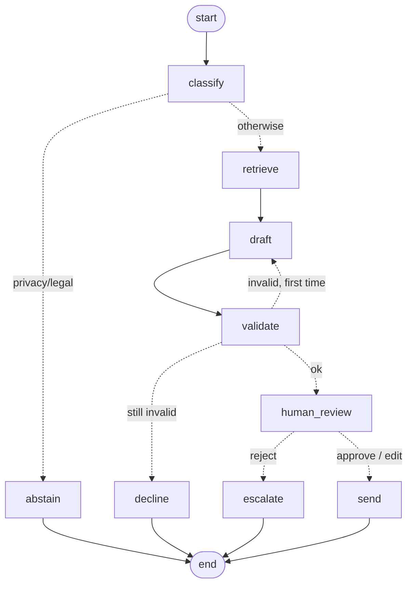

# LangGraph support agent

A small, runnable LangGraph project: an agent that drafts customer-support replies, refuses on
privacy and legal topics, checks its own output in code, gets one repair attempt, and **pauses
for a human to approve, edit or reject** before anything is sent. Every step is checkpointed to
SQLite, so a paused run survives the process exiting and leaves a full audit trail.

It mirrors the Finch support agent, rebuilt as an explicit graph.



## Run it

```bash
cd ~/Code/langgraph-support-agent
source .venv/bin/activate          # Python 3.14, langgraph 1.2
# NVIDIA_API_KEY comes from ~/.zprofile (model: nemotron-3-super)

python -m support_agent.cli run "My UBS connection says needs reauthorisation"
#   -> classify, retrieve, draft, validate ... PAUSED for human review (prints a thread id)

python -m support_agent.cli resume <thread-id> approve            # or: reject
python -m support_agent.cli resume <thread-id> edit "Your text"   # human rewrites it
python -m support_agent.cli history <thread-id>                   # every checkpoint
python -m support_agent.cli graph                                 # Mermaid diagram

python -m pytest -q                # 7 tests, scripted fake model, no API calls
```

## The concepts, and where to find them

| LangGraph concept | What it means | In this repo |
|---|---|---|
| **State** | One typed dict shared by all nodes. A node returns only the keys it changes, and LangGraph merges them | `SupportState` in `agent.py` |
| **Nodes** | Plain functions `(state) -> partial update`. An LLM call, a tool call or plain code | `classify`, `retrieve`, `draft`, `validate`, ... |
| **Edges** | `add_edge` for fixed order; `add_conditional_edges` + a router for branches and loops | `route_after_classify`, `route_after_validate` (the repair loop), `route_after_review` |
| **Checkpointer** | Saves state after every node. Required for pausing, resuming and history | `SqliteSaver` in `cli.py`, `InMemorySaver` in the tests |
| **Thread** | One conversation or run, identified by `thread_id` in the config. Each thread has its own checkpoints | `config = {"configurable": {"thread_id": ...}}` |
| **Interrupt** | `interrupt(payload)` pauses inside a node; `Command(resume=value)` continues, and `value` becomes `interrupt()`'s return | `human_review` node; `resume` command |
| **Streaming** | `graph.stream(..., stream_mode="updates")` yields each node's update as it finishes | `_stream` in `cli.py` |
| **History / time travel** | `get_state_history` returns every checkpoint: an audit trail, and a point you can resume from | `history` command; last test |

## Design choices worth explaining in an interview

- **The model never grades itself.** `validate` is deterministic code: allowed citations, length,
  no promises or guarantees, nothing that looks like an IBAN. Errors are fed back into exactly one
  repair turn, then the graph declines rather than looping forever.
- **Refuse before drafting.** Privacy and legal tickets branch to `abstain` before any draft exists,
  so there's nothing risky to leak or accidentally approve.
- **Humans approve consequential actions.** `interrupt` makes the approval a real, persisted state
  in the system, not a convention. The run can wait hours; the process doesn't need to stay alive.
- **The model is injected.** The graph only depends on `complete_json(system, user)`, so the same
  graph runs on NVIDIA, OpenAI, Bedrock or Gemini, and the tests use a scripted fake.
- **Resume re-runs the interrupted node.** On resume, LangGraph re-executes `human_review` from the
  top. Code before `interrupt()` must therefore be side-effect free, or idempotent.

## When I'd use LangGraph, and when not

Use it for branches, loops, retries, human approval and resume-after-failure, and anywhere an
auditable step-by-step trace matters (a bank approving an agent's payment action is the classic
case). Skip it for a single LLM call or a simple tool loop, where the vendor SDK is enough, and for
human-paced workflows spanning days, where Jira and git are the better source of truth. That's the
split at Finch: explicit code in the product, Jira and git for the delivery agents.

## Try next

1. Swap `kb.retrieve` for a real vector search (pgvector or a local embedding model).
2. Add a `lookup_account` tool node so the draft can use live account state.
3. Make the human gate conditional: auto-send low-risk categories, interrupt only for billing.
4. Add a second agent (a supervisor routing between "support" and "billing" specialists).
